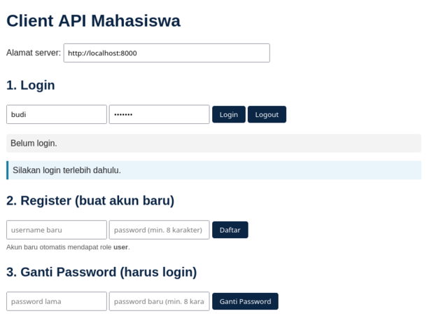

# API Mahasiswa + Autentikasi JWT (Pertemuan 7) — PHP + MySQL

Proyek praktikum P7 **beserta Tugas Pertemuan 7** (register, ganti password,
role dosen, analisis log, dan pengujian tambahan).



*Form login, register, dan ganti password pada client web.*

## 1. Menyiapkan database

- Instalasi baru: impor `database/mhs.sql` (phpMyAdmin) — membuat tabel
  `mhs`, `users`, `log_api` beserta akun contoh.
- Database yang sudah ada: impor `database/migrasi_p7_tugas.sql` untuk
  menambahkan akun `dosen` tanpa menghapus data lama.

Akun latihan:

| Username | Password   | Role  | Hak akses                                      |
|----------|------------|-------|------------------------------------------------|
| admin    | admin123   | admin | semua endpoint                                |
| dosen    | dosen123   | dosen | lihat data + PUT; tidak boleh POST/DELETE/log  |
| budi     | budi123    | user  | hanya lihat data (`GET /mhs`)                  |

## 2. Menjalankan server

Salin folder ke `htdocs`. Server: `http://localhost/api-mhs-auth/server`

Tanpa Apache: `cd server && php -S localhost:8000 router.php`

## 3. Endpoint

| Method | URL            | Akses            | Keterangan                          |
|--------|----------------|------------------|-------------------------------------|
| POST   | `/login`       | publik           | mendapat token JWT                  |
| POST   | `/register`    | publik           | daftar akun baru, role otomatis `user` |
| GET    | `/me`          | token            | data akun yang sedang login         |
| PUT    | `/me/password` | token            | ganti password (wajib password lama) |
| GET    | `/mhs`, `/mhs/{id}` | token       | lihat data                          |
| POST   | `/mhs`         | token + admin    | tambah data                         |
| PUT    | `/mhs/{id}`    | token + admin/dosen | ubah data                        |
| DELETE | `/mhs/{id}`    | token + admin    | hapus data                          |
| GET    | `/log`         | token + admin    | 20 catatan log terakhir             |

Contoh register:

```json
POST /register
{"username": "siti", "password": "rahasia123"}
```

Jawaban: `201` berhasil, `409` username sudah dipakai, `422` data tidak valid
(password minimal 8 karakter).

Contoh ganti password (header `Authorization: Bearer <token>`):

```json
PUT /me/password
{"password_lama": "rahasia123", "password_baru": "rahasia456"}
```

Jawaban: `200` berhasil, `401` password lama salah, `422` data tidak valid.

## 4. Analisis log

Tiga query analisis `log_api` ada di `database/analisis_log.sql`:

1. jumlah login gagal per username,
2. 5 IP dengan request terbanyak,
3. jumlah status 401/403/429 per hari.

Jalankan lewat phpMyAdmin (database `kampus_db`) atau
`mysql -u root kampus_db < database/analisis_log.sql`.

## 5. Pengujian

```bash
php client/test_client.php http://localhost:8000
```

Menguji autentikasi, token palsu, otorisasi, CRUD, rate limiting, logging,
**register, ganti password, dan role dosen**. Total **50 pengujian**.

Catatan: `$batas_umum = 120` request/menit per IP. Jika tes dijalankan
berulang kali dalam satu menit, tunggu 1 menit agar tidak mendapat 429.

## 6. Latihan

- `php latihan/jwt_demo.php`
- `php latihan/uji_rate_limit.php <url>`

Client web: buka `client/index.html`. Halaman ini sudah punya form
**login, register, ganti password**, daftar/tambah/hapus mahasiswa, dan log.

Jika memakai `php -S` (tanpa XAMPP), jalankan dua server:

```bash
# Terminal 1 - API (port 8000)
cd server && php -S localhost:8000 router.php

# Terminal 2 - UI (port 8080)
cd client && php -S localhost:8080
```

Lalu buka `http://localhost:8080/index.html`. Alamat API otomatis diisi
`http://localhost:8000`; jika memakai XAMPP, isi
`http://localhost/api-mhs-auth/server`.

Catatan: server UI harus dijalankan dari folder `client`, bukan folder
`server`. Jika port 8080 sudah dipakai proses lain, hentikan proses itu
(Ctrl+C) atau gunakan port lain, misalnya `php -S localhost:8081`.
